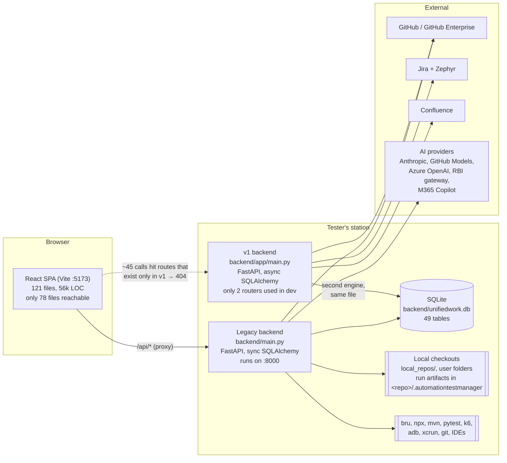

# 2. Current architecture (as is, October 2026)

All facts below were measured in the code at commit `0364cc2` and checked against the running development server.
LOC means lines of code.

## 2.1 The big picture

## 2.2 Backend

### Two applications in one folder

| | Legacy app (`backend/main.py`) | v1 app (`backend/app/main.py`) |
|---|---|---|
| Used by | Daily development (`PORT=8000 ../.venv/bin/python main.py`) | Docker, CI tests |
| Style | Sync SQLAlchemy, integer IDs | Async SQLAlchemy, UUID IDs (Postgres types) |
| Routes | 185 paths: projects, runs, AI, office, settings, integrations, messaging, login | `/api/v1/*`: auth, projects, suites, runs, reports, webhooks, tasks, community, Zephyr planner |
| Shared | Mounts two v1 routers: `settings` (Jira, Confluence, GitHub, Zephyr settings) and `devices` | Mounts three legacy routers |

Problems this causes:
- **Missing routes.** About 45 frontend calls go to `/api/<domain>` routes that only the v1 app defines (under
  `/api/v1`). On the running app they return 404: community forum, tasks, test manager (epics), Zephyr planner,
  publish (branch, commit, push, PR), scripts run, library install, workflow dispatch, local sync.
- **Duplicate domains.** 27 project routes, 13 integration routes and 6 settings routes exist in both apps. The
  startup log shows FastAPI "Duplicate Operation ID" warnings.
- **Two user models on one `users` table**, with incompatible schemas. A role check in the v1 test manager compares
  values of two different enums, so it never matches.

### Code size

| File | LOC | What it holds |
|---|---|---|
| `api/project_routes.py` | 4,226 | Projects, local checkout and editor, runs (Bruno, Appium, frameworks), Allure, GitHub overview, scaffolds |
| `main.py` | 2,517 | Login, 2FA, organizations, users, community AI chat, startup |
| `app/api/v1/endpoints/projects.py` | 2,228 | v1 projects, GitHub, local git operations |
| `app/api/v1/endpoints/settings.py` | 2,064 | Jira, Confluence, GitHub, Zephyr settings, release analysis |
| `api/office_routes.py` | 1,193 | Desk, parking and meeting-room booking (unused by the UI) |
| `messaging_routes.py` | 1,074 | Direct messages (unused by the UI) |

There are 127 non-test Python files with 41,470 LOC in total. `app/services/` holds 35 service modules (13,200 LOC).
The useful ones are reused as they are by the redesign:

| Area | Services |
|---|---|
| Running tests | `framework_run_service` (detects and runs about 20 frameworks), `appium_project_service`, `device_service`, `junit_parser` |
| Local git | `local_repo_service`, `local_import_service`, `changed_tests_service` |
| GitHub | `github_service` (GitHub Enterprise aware), `github_workflow_service`, `github_overview_service` |
| Jira and Confluence | `test_manager_service`, `zephyr_service`, `confluence_release_analyzer`, `automation_generator_service` |
| AI | `ai_provider_service`, `ai_project_service`, `rbi_gateway_service` |
| Project setup and files | `scaffold_service` (18 starter templates), `properties_service`, `bruno_env_service`, `ide_service`, `station_tools_service` |

### Data

- **One SQLite file**, `backend/unifiedwork.db`: 49 tables, 21 users. It is opened by two engines (sync and async).
- **Two declarative bases** that both map `users` and `projects`. The table `projects_legacy_backup` and 241 rows in
  `test_runs` belong to the abandoned UUID model.
- **No real migrations.**
  - Alembic has 4 Postgres-only revisions, and the SQLite file has no `alembic_version` table.
  - `migrations/` holds 10 one-off scripts.
  - `init_db()` runs `create_all` plus ad-hoc `ALTER TABLE` statements at every start.
- **Personal settings in a JSON column.** Tokens and settings live in `users.settings_json`: GitHub, Jira and
  Confluence tokens, AI keys, linked checkout paths. They are stored unencrypted.

### Authentication and roles

- **Login.**
  - JWT, HS256, valid for 30 minutes. A refresh token exists in v1, but the frontend never uses it.
  - Login is limited to 5 attempts per minute.
  - 2FA exists in the backend but has no screen.
- **Seeded accounts.** Every start creates default accounts with fixed passwords (`admin/admin123`, demo users
  `demo123`).
- **Roles.**
  - Legacy: `super_admin, admin, org_admin, community_lead, automation_lead, automation_user, user, viewer`.
  - v1: `admin, automation_lead, automation_user, developer, viewer`.
  - The database currently holds users in all eight legacy roles.
- **Where rights are checked.** The checks are scattered:
  - `check_organization_member` (66 calls; it only checks that the user has an organization)
  - `_require_editor` (blocks viewers, 13 calls)
  - `check_product_manager_access` (17 calls; requires the "product" community)
  - three different `get_current_user` implementations
  - per-endpoint role sets in v1

### Runtime

- **Test runs** are started as background tasks in the API process and stream logs over a WebSocket
  (`/api/v1/runs/ws/{run_id}`).
- **The Allure "report" is a custom HTML page** (`api/allure_report_template.py`) made for Bruno results. The real
  Allure CLI is never used, so there is no history and no trend data.
- **Scheduling does not work.** Celery and Redis are configured only for the v1 app, and its cron scheduling is never
  called.
- **No notification system.** WebSockets are used only for run logs.
- **Unused AI agents.** The seven UnifiedWork agents need `OPENAI_API_KEY` and are not used by the UI.

## 2.3 Frontend

| Item | Today |
|---|---|
| Stack | React 18, Vite 5, TypeScript 5 (strict), Tailwind 3, zustand, axios, lucide icons, recharts, framer-motion, CodeMirror 6 |
| Routing | `App.tsx` with guards for login, roles and idle logout (15 min). Most screens are lazy loaded |
| Navigation | One top bar: Dashboard, Projects, Jira and Confluence, Upskilling, Community, Users, Settings. No side bar on desktop |
| State | One zustand store, `useAppStore.ts` (1,048 LOC, 46 fields). 48 files fetch data by hand in `useEffect`; no data-fetching library |
| API client | `services/api.ts`: 2,031 LOC, 204 methods, 9 fallbacks for missing endpoints |
| Shared UI | Only CSS classes (`btn-primary`, `form-input`, …). No shared Modal, Tabs, Table, Dropdown or Toast: 14 hand-made overlays, about 25 `alert()`/`confirm()` calls, 8 separate resizable split panes |
| Roles in the UI | Only `/users` is restricted. Pages repeat role string comparisons in at least 9 places |
| Look | Brand colour yellow, but active states use blue (674 blue against 137 yellow class uses). The theme preference saved on the server is never applied |
| Tests | None. No ESLint configuration (the lint script fails) |

### Screens today

| Area | Screens | State |
|---|---|---|
| Dashboard | KPIs, trends, recent runs | Works |
| Projects › Overview | Projects, GitHub facts, starter projects | Works |
| Projects › Local and GIT | 3-Panel, Compare, Editor, Scripts, Publish, Structure, Analyzer | 3-Panel, Compare and Editor work. Publish and Scripts run return 404. Structure and Analyzer repeat other screens |
| Projects › AI Driven implementation | Analysis, AI Assistant workspace, Test | Works (added in PR #1) |
| Projects › Test Runs | Local, GitHub Action, Devices | Local and Devices work. Workflow dispatch returns 404 |
| Projects › Library, Analytics | Dependencies, run analytics, imported Allure, flaky tests | Partial |
| Jira and Confluence | Zephyr planner, epics and stories, tasks, Confluence release analyzer | Confluence works. Epics, Zephyr and Tasks return 404 |
| Upskilling | 15 programs, 90 lessons, quizzes | Works, but progress is kept only in the browser |
| Community | Forum | Returns 404 |
| Users | User management | Role and lead changes are silently not saved |
| Settings | Profile, security, preferences, privacy, data, billing, connections (Jira, Confluence, GitHub, AI) | Connections work. Billing, data and privacy are mock-ups |

### Dead code

These files are never loaded by the app:
- the `src/app/**` Next.js leftovers;
- 20 top-level components (chat panels, admin dashboard, floor-plan editor, …);
- `components/projects/*`, which is an internal Jira clone;
- `JiraProjectsPage` and `ProjectsPage`;
- two extra API clients.

There are also duplicates: two file trees, two editors, two diff viewers, and three versions of the messenger.

## 2.4 Gaps against the goals

| Goal | Exists today | Missing |
|---|---|---|
| Implement tests from Jira and Confluence requirements, AI optional | Story tree; "to be automated" Jira task; Zephyr → Bruno generator; AI workspace with diff review | Story detail (description, acceptance criteria); Confluence requirements search and viewer; "start work from a story" with the story as AI context; saved traceability story ↔ test ↔ run ↔ PR |
| All test types | Local runs for about 20 frameworks including k6 and Appium; GitHub Actions sync; devices | Test types and suites (smoke, regression, performance); shared environments; schedules; performance trends; one result model |
| Common Allure report, uploaded to Confluence | Custom HTML page for Bruno runs; import of allure-results; read-only Confluence client | Real Allure generation with history for every framework; Confluence publishing |
| Deployment notifications | Version extraction from Confluence release pages | Deployment events; service ↔ test project mapping; notification centre; subscriptions |
| Code review of open PRs | Create PR (404 today); compare views | PR list, diff review, comments, approve or request changes, checks, AI review help |
| Grow manual testers | Upskilling content and quizzes (browser only); starter projects; AI | Saved progress; practice tasks; hints; trainee dashboard for leads; promotion flow |
| Six roles with tags | super_admin, automation_lead, automation_user, viewer | Senior and Trainee roles; tags; one permission matrix enforced in backend and UI |
