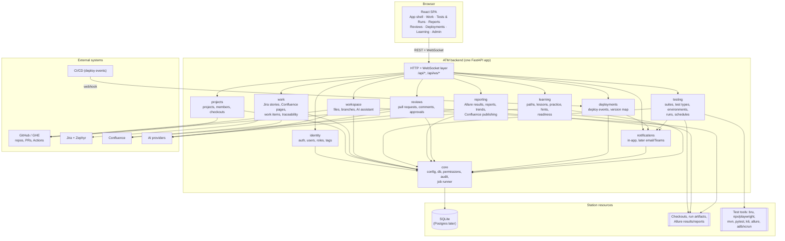
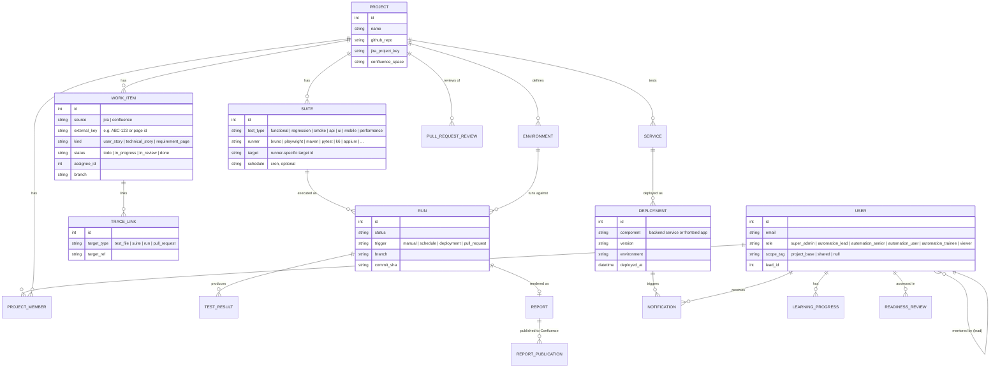
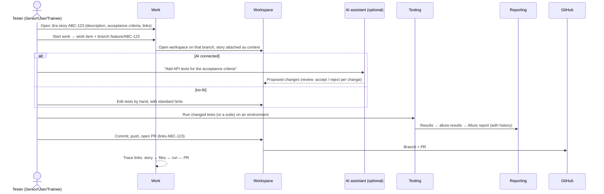
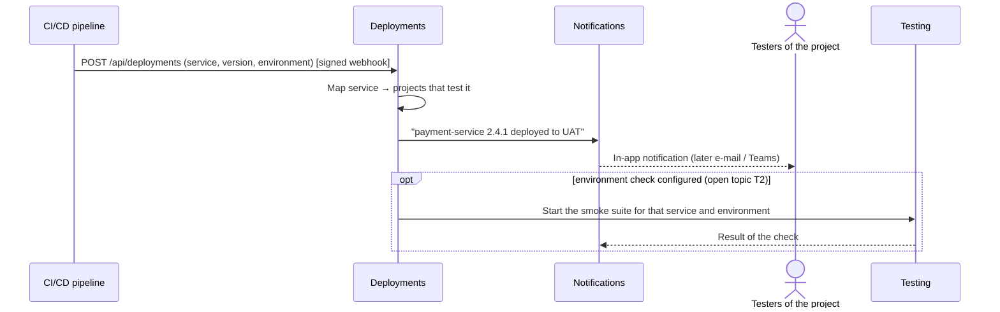
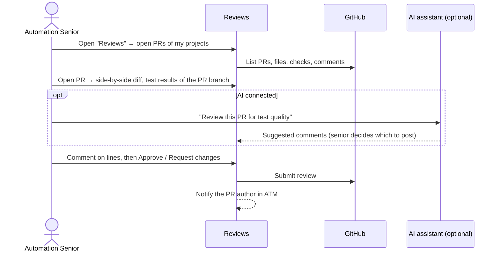

# 3. Target architecture

## 3.1 Principles

1. **One backend, one data model.** One FastAPI application. Every domain is a module with its own router, service
   and models. No second app, and no duplicate tables.
2. **Keep what works.** The test runners, git, GitHub, Jira, Confluence and AI services in `app/services/` are reused
   as they are and moved into their modules. The redesign changes structure, not their behaviour.
3. **Permissions in one place.**
   - Every endpoint declares the permission it needs, such as `require("pr.review")`.
   - One table maps roles and tags to permissions.
   - The UI reads the same permissions from `/api/me` to show or hide actions.
4. **Everything is a project.** Stories, tests, runs, reports, deployments and pull requests all belong to a project.
   Project access follows the user's tag (see [04-roles-and-permissions.md](04-roles-and-permissions.md)).
5. **Works without AI.** The AI assistant is an extra. Every workflow can be finished by hand.
6. **Local first, server ready.**
   - The app runs on the tester's station, with SQLite and local checkouts.
   - Configuration (database URL, base URLs, secrets) comes from the environment.
   - So a shared team server with Postgres is possible later (open topic T5).

## 3.2 System view



## 3.3 Backend modules

The backend moves to this layout. The `app/` package becomes the only application. `backend/main.py` stays as a thin
start script that imports it, so the daily start command does not change.

```
backend/
  main.py                      # start script: uvicorn app.main:app (same command as today)
  app/
    main.py                    # creates the FastAPI app, mounts module routers
    core/                      # config, db (one engine, one Base), security, permissions, audit, jobs
    modules/
      identity/                # login, tokens, /api/me, users, roles, tags, project assignment
      projects/                # projects, members, GitHub link, local checkout link, overview
      work/                    # Jira stories, Confluence pages, work items, traceability links
      workspace/               # file tree, editor, branches, publish (commit/push/PR), AI assistant
      testing/                 # test types, suites, environments, runs, schedules, devices, runners
      reporting/               # allure results, report generation, history, trends, Confluence publish
      reviews/                 # pull requests, diff, comments, approvals, AI review
      deployments/             # deploy events (webhook/poll), service ↔ project map
      notifications/           # notification centre, subscriptions, delivery channels
      learning/                # paths, lessons, quizzes, practice tasks, hints, progress, readiness
      settings/                # personal connections: GitHub, Jira, Confluence, AI
    services/                  # existing integration services, kept and moved over time
  alembic/                     # the only way the schema changes (SQLite and Postgres)
  tests/
```

Each module has the same shape: `router.py` (HTTP), `service.py` (logic), `models.py` (tables), `schemas.py`
(request/response types). Routers stay thin and never call other routers.

### API conventions

- **Paths.** Everything lives under `/api/...`. The `/api/v1` prefix is removed, and old paths that the frontend
  still uses get a compatibility redirect for one phase.
- **IDs.** Integer IDs everywhere, as in today's real data.
- **Errors.** One error shape: `{"detail": "...", "code": "permission_denied"}`.
- **Pagination.** `?limit=&cursor=`.
- **Live data.** WebSockets under `/api/ws/`: run logs and notifications. The frontend reaches them through the same
  proxy as REST, with no hard-coded port.

## 3.4 Data model



### Notes on the data model

- **What stays.** Users, projects, runs (`analytics_runs`, `analytics_suites`) and Allure imports stay, and are
  renamed and extended through Alembic migrations. The data of the 21 existing users is migrated, not recreated.
- **What is removed.**
  - Tables of the removed features: office, billing, subscriptions, organizations, messaging, chat sessions,
    forum (unless kept for learning Q&A), issues and sprints.
  - The `projects_legacy_backup` table and the second `Base`.
- **Personal secrets.**
  - Personal tokens (GitHub, Jira, Confluence, AI keys) move from `settings_json` into a `user_connections` table.
  - They are encrypted with a key from the environment (`ATM_SECRET_KEY`).
  - They are never sent back to the browser.
- **Traceability.**
  - A `WORK_ITEM` is one Jira story or Confluence page that someone works on.
  - Its links point to the test files changed, the suites, the runs and the pull request. That answers "which tests
    cover this story, and did they pass?".

## 3.5 Key flows

### Story → tests → run → report → PR



### Deployment → notification → check



### Pull request review



## 3.6 Reporting: one Allure pipeline

1. **Results first, report second.** Every run writes `allure-results/`:
   - Frameworks that have an Allure adapter use it: Playwright, pytest, JUnit/TestNG, Cucumber.
   - The other results are converted by ATM: JUnit XML, Bruno JSON, Newman, k6 summary.
2. **Generation with history.** ATM generates the report with the Allure command line (`allure generate`) and copies
   `history/` from the previous report of the same suite, so trends work.
3. **Storage.** Reports live in the artifacts folder, are linked to the run, and are served by ATM.
4. **Confluence publishing** (details are open topic T1). A publisher module creates or updates a Confluence page
   from the report summary and attaches the report, with the space and parent page configured per project.

## 3.7 Frontend architecture

| Concern | Choice |
|---|---|
| Stack | React 18, Vite, TypeScript strict, Tailwind. The stack is kept: the team knows it, and the build is fast |
| Server data | **TanStack Query**: caching, refetching and loading/error states in one place, replacing hand-written `useEffect` fetching |
| Client state | zustand for UI state only: theme, selected project, panels |
| Routing | React Router with nested layouts. Every tab is a URL, so refresh and links keep the place |
| Components | A small ATM component kit under `src/ui/`: Button, Input, Select, Tabs, Dialog, Drawer, Toast, Table, Badge, Card, EmptyState, Skeleton, CommandPalette. Built on Radix UI primitives for keyboard and screen-reader support |
| API client | Generated types from the backend OpenAPI schema; one small client per module instead of a single 2,000-line file |
| Permissions | `usePermission("pr.review")` reads the list from `/api/me`. Navigation and buttons use it, and routes are guarded by it |
| Tests | Playwright end-to-end tests in `frontend/e2e/`, run against the real backend with a seeded test database. Vitest for logic-heavy units |

Frontend folders:

```
frontend/src/
  app/            # router, providers, shell (sidebar, top bar, command palette)
  ui/             # component kit + design tokens
  features/
    home/ work/ workspace/ testing/ reports/ reviews/ deployments/ learning/ admin/ settings/
  lib/            # api client, query keys, permissions, websocket
```

## 3.8 What gets removed

| Area | Backend | Frontend |
|---|---|---|
| Second backend | `app/api/v1/*` routers once absorbed; `app/models/models.py`; `app/db/session.py` async engine | `api_new.ts`, compatibility fallbacks in `api.ts` |
| Office booking | `api/office_routes.py`, `models/office_models.py`, office migrations | `OfficeManagement`, `FloorPlanEditor` |
| Billing / subscriptions / plans | `core/feature_flags.py`, `core/feature_gates.py`, billing tables | `SubscriptionBillingPanel` |
| Multi-organization | organizations, org access tokens, org admin role | `AdminDashboard` |
| Messaging and agents | `messaging_routes.py`, `agents/`, `tools/qa_tools.py`, `/api/communities/*/chat` | `MessengerView*`, chat panels, `ChatContext` |
| Mock settings | data export, OAuth integrations, webhooks, privacy | `DataIntegrationsPanel`, `CommunityPrivacyPanel` |
| Leftovers | one-off root scripts (`_get_token.py`, `create_*`, `migrate_*`, …), 0-byte `.db` files | `src/app/**` (Next.js), dead components, `next.config.js`, unused dependencies |
