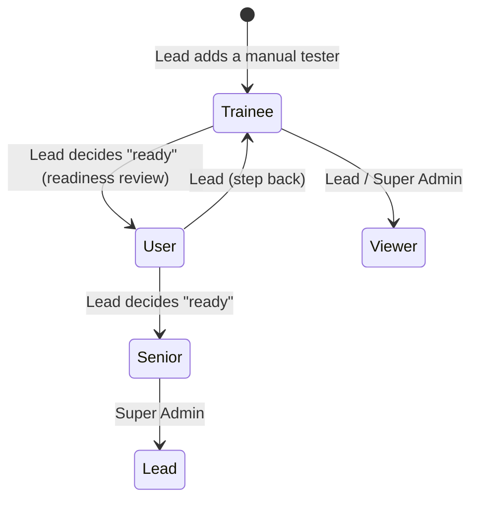

# 4. Roles and permissions

## 4.1 Roles

| Role | Code | Who | In one sentence |
|---|---|---|---|
| Super Admin | `super_admin` | Platform owner | Configures the install and can do everything |
| Automation Lead | `automation_lead` | Team lead | Manages people and projects, decides promotions, can do everything a Senior can |
| Automation Senior | `automation_senior` | Experienced automation tester | Implements and runs tests, publishes reports, reviews and approves pull requests, mentors trainees |
| Automation User | `automation_user` | Automation tester | Implements and runs tests, opens pull requests, comments on reviews |
| Automation Trainee | `automation_trainee` | Manual tester learning automation | Learns, practises and implements tests on their own branches; their work is reviewed before it is merged |
| Viewer | `viewer` | Anyone who follows results | Reads dashboards, runs and reports; changes nothing |

## 4.2 Tags: `project_base` and `shared`

Every Automation Senior, User and Trainee has exactly one scope tag:

| Tag | Meaning |
|---|---|
| `project_base` | Works only on the projects they are assigned to. A lead assigns them to projects |
| `shared` | Works on every project, for example a senior who supports all teams, or a performance specialist |

- **Super Admin and Automation Lead** have no tag.
  - Super Admin sees every project.
  - A Lead sees the projects they lead, plus the projects of the people assigned to them.
- **Viewer** has no tag either and sees the projects they are assigned to. A Viewer with no assignment sees nothing
  but their own profile.

## 4.3 Permission list

Permissions are named `area.action`. The backend checks them on every endpoint. The UI receives the list for the
current user from `/api/me` and uses it to show or hide actions.

**Project scope.** "✓ (own)" means the user may do it only on projects in their scope (section 4.2). Without that
mark, ✓ still applies only to projects the user can see.

| Permission | Super Admin | Lead | Senior | User | Trainee | Viewer |
|---|---|---|---|---|---|---|
| **Projects** | | | | | | |
| `project.view` | ✓ | ✓ | ✓ (own) | ✓ (own) | ✓ (own) | ✓ (own) |
| `project.create` | ✓ | ✓ | | | | |
| `project.delete` | ✓ | ✓ | | | | |
| `project.configure` (GitHub, Jira, Confluence links) | ✓ | ✓ | ✓ (own) | | | |
| `project.members.manage` | ✓ | ✓ | | | | |
| **Work items (Jira and Confluence)** | | | | | | |
| `work.view` | ✓ | ✓ | ✓ | ✓ | ✓ | |
| `work.start` (create work item and branch) | ✓ | ✓ | ✓ | ✓ | ✓ | |
| `work.assign` (assign a story to someone) | ✓ | ✓ | ✓ | | | |
| `jira.write` (create tasks, links, comments, status) | ✓ | ✓ | ✓ | ✓ | | |
| **Workspace and code** | | | | | | |
| `code.edit` (edit files in the local checkout) | ✓ | ✓ | ✓ | ✓ | ✓ | |
| `code.push` (commit and push a branch) | ✓ | ✓ | ✓ | ✓ | ✓ ¹ | |
| `pr.create` | ✓ | ✓ | ✓ | ✓ | ✓ | |
| `ai.use` (AI assistant, when connected) | ✓ | ✓ | ✓ | ✓ | ✓ | |
| **Testing** | | | | | | |
| `run.view` | ✓ | ✓ | ✓ | ✓ | ✓ | ✓ |
| `run.execute` (local runs, any test type) | ✓ | ✓ | ✓ | ✓ | ✓ | |
| `run.execute.ci` (dispatch GitHub Actions) | ✓ | ✓ | ✓ | ✓ | | |
| `suite.manage` (suites, test types, schedules) | ✓ | ✓ | ✓ | ✓ ² | | |
| `suite.delete` (permanently, an archived suite and its runs) | ✓ | ✓ | | | | |
| `environment.manage` | ✓ | ✓ | ✓ | | | |
| `device.manage` (emulators, simulators) | ✓ | ✓ | ✓ | ✓ | ✓ | |
| **Reporting** | | | | | | |
| `report.view` | ✓ | ✓ | ✓ | ✓ | ✓ | ✓ |
| `report.publish` (to Confluence) | ✓ | ✓ | ✓ | | | |
| **Reviews** | | | | | | |
| `pr.view` | ✓ | ✓ | ✓ | ✓ | ✓ | ✓ |
| `pr.comment` | ✓ | ✓ | ✓ | ✓ | ✓ | |
| `pr.review` (approve / request changes) | ✓ | ✓ | ✓ | | | |
| **Deployments and notifications** | | | | | | |
| `deployment.view` | ✓ | ✓ | ✓ | ✓ | ✓ | ✓ |
| `deployment.configure` (service map, webhooks, checks) | ✓ | ✓ | | | | |
| **Learning** | | | | | | |
| `learning.use` (paths, lessons, practice) | ✓ | ✓ | ✓ | ✓ | ✓ | |
| `learning.mentor` (see trainees' progress, review practice) | ✓ | ✓ | ✓ | | | |
| `learning.manage` (paths, practice tasks, hints) | ✓ | ✓ | | | | |
| `readiness.decide` (promote / change role) | ✓ | ✓ ³ | | | | |
| **Administration** | | | | | | |
| `user.view` (only the roles below one's own; a Super Admin sees everyone) | ✓ | ✓ | | | | |
| `user.manage` (create, deactivate, role, tag, lead) | ✓ | ✓ ³ | | | | |
| `settings.system` (install-wide settings and integrations) | ✓ | | | | | |
| `audit.view` | ✓ | ✓ | | | | |

¹ **Trainees push only to their own branches.** ATM refuses a push of a trainee to the default branch (for example
`main`) or to a branch another person started. Their work reaches the default branch only through a reviewed pull
request.

² **Users manage only the suites they created.**

³ **Leads change roles only for their own people.** That means the users assigned to them, and only up to
`automation_senior`. Only a Super Admin can create Leads and Super Admins.

## 4.4 Promotion flow

- **What the lead sees.** The readiness view shows the trainee's numbers: lessons and quizzes done, practice tasks
  reviewed, work items finished, PRs merged after review, runs. The exact criteria are open topic T4.
- **How a promotion is recorded.** The lead writes a short note and confirms. ATM changes the role and logs the
  decision (who, when, from, to, note). The user gets a notification.
- **Nothing is automatic.** ATM never promotes anyone by itself; it only shows the evidence.

## 4.5 Migration of existing users

| Current role | New role | Tag |
|---|---|---|
| `super_admin` | `super_admin` | – |
| `admin`, `org_admin` | `automation_lead` | – |
| `automation_lead` | `automation_lead` | – |
| `community_lead` | `automation_senior` | `shared` |
| `automation_user` | `automation_user` | `project_base` |
| `user`, `developer` | `automation_user` | `project_base` |
| `viewer` | `viewer` | – |

- The migration is an Alembic revision. It writes a log table with the old and the new role of every user, so the
  Super Admin can review the result.
- Existing lead assignments (`assigned_lead_id`) are kept.
- So that nobody loses access (today everyone sees every project), every migrated `project_base` user and every
  Viewer becomes a member of all existing projects. Leads narrow this down afterwards on the Users screen.
- People who register themselves become Viewers with no projects, until a lead assigns them.

## 4.6 How it is enforced

- **Backend.**
  - `app/core/permissions.py` holds the matrix above as data.
  - Endpoints use `Depends(require("pr.review", project_from="project_id"))`.
  - Project scope is checked in the same dependency: tag, membership and lead relation. Endpoints that take the
    project in the body check it in the handler with `ensure(db, user, permission, project_id)`.
  - A refusal answers `403` with `{"detail": "…", "code": "permission_denied"}`.
  - Personal endpoints (own profile, password, 2FA, personal connection settings) need only a signed-in user.
  - The run log WebSocket checks `run.view` and the project scope before it accepts. The browser sends the token as
    the `atm-token` subprotocol, so it never appears in a URL or an access log.
  - The old helpers are deleted: `check_organization_member`, `_require_editor`, `check_product_manager_access`.
- **Frontend.**
  - `/api/me` returns `role`, `scope_tag`, `permissions[]` and `project_ids[]`.
  - `usePermission()` and `<Can permission="…">` hide what the user may not do.
  - Hiding is for clarity only; the backend is the authority.
- **Tests.**
  - A backend test walks the whole matrix for each role, and fails when an endpoint declares no permission and is
    not on the list of personal endpoints (`backend/tests/test_permissions.py`).
  - The UI tests log in as each role and check the navigation and the main buttons.
