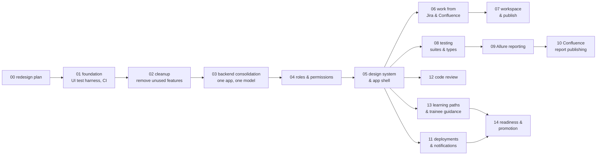

# 6. Implementation plan

Each phase is one branch and one PR (see [07-delivery-workflow.md](07-delivery-workflow.md)). Phases are ordered so
that the app works after every merge.

## 6.1 Phase map

Phases on the same level can be worked on in parallel after their parent is merged: 06, 08, 11, 12 and 13 after 05.
They touch different modules, so their PRs do not conflict (see section 6.4).

## 6.2 Phases

### Phase 00: `feature/phase_00_redesign_plan`
- **Goal:** agree on the plan.
- **Delivers:** these documents in `docs/redesign/`.
- **UI tests:** none, because there is no code change.

### Phase 01: `feature/phase_01_foundation`
- **Goal:** a safety net before anything moves.
- **Delivers:**
  - A Playwright UI test project in `frontend/e2e/`.
  - Scripts that start the backend on a temporary SQLite database with seeded users, one per role, and the frontend.
  - Smoke tests for today's main screens: login, Home/Dashboard, Projects, Test Runs, AI Assistant, Settings.
  - CI:
    - The branch guard also accepts `feature/phase_*`.
    - A UI-test job runs the Playwright suite.
  - An ESLint configuration that passes.
  - The old root folders `e2e-tests/` and `playwright-tests/` are removed (they target screens that no longer exist).
- **Done when:** the UI tests pass locally and in CI on today's app.

### Phase 02: `feature/phase_02_cleanup`
- **Goal:** remove what does not serve the goals.
- **Delivers:**
  - Deleted: office booking, billing and subscriptions, multi-organization, messaging, UnifiedWork agents, mock
    privacy, data-export and webhook settings, dead frontend code (`src/app/**`, unused components, Next.js
    leftovers), unused dependencies, one-off root scripts.
  - Removed from the navigation: Community, until phase 13 decides whether Q&A stays inside Learning.
  - Fixed: the Romanian error text and `lang="ro"`; the Tailwind content paths; the fixed seed passwords, which now
    come from environment variables in development only.
- **UI tests:** the remaining screens still load. Removed routes redirect to Home.
- **Left for later phases (decided while building phase 02):**
  - The tables of the removed features stay in existing databases; phase 03 drops them with its Alembic baseline.
  - One default organization stays, because users and projects still filter on `organization_id`. Organization
    management, blocking, seat limits and plans are gone. The org-scoped user endpoints
    (`/api/organizations/{id}/users`) stay until phase 04 replaces the Users screen, and so does the `org_admin` role.
  - The v1 app (`app/`) keeps its own billing, integration and webhook endpoints until phase 03 removes it.
  - Security (sessions, API tokens, login history) stays in Settings; phase 05 decides its place.

### Phase 03: `feature/phase_03_backend_consolidation`
- **Goal:** one backend and one data model.
- **Delivers:**
  - The `app/` layout from [03-target-architecture.md › 3.3](03-target-architecture.md#33-backend-modules).
  - `backend/main.py` becomes the start script.
  - Moved into modules: the v1 features the UI needs (Jira, Confluence and Zephyr settings, Publish: branch, commit,
    push, PR, scripts run, library install, workflow dispatch, local sync). The four features that return 404 today
    work again.
  - One SQLAlchemy engine and one `Base`. Alembic baseline for SQLite (and Postgres), including today's tables.
  - The repeated checkout-path code is replaced by one helper.
  - Personal tokens move to an encrypted `user_connections` table.
  - The frontend `api.ts` loses its compatibility fallbacks.
- **UI tests:** Publish (commit, push to a local bare repository, PR request), Scripts run, Jira/Confluence settings,
  and everything from phase 01.
- **Decided while building phase 03:**
  - The test manager (epics, stories, cases), the Zephyr planner, team tasks and the community forum also moved, so
    they work again instead of being lost with the second backend. Community stays hidden until phase 13.
  - The database is configured with `ATM_DATABASE_URL` (or `ATM_DATABASE_PATH`); the second backend's
    `DATABASE_URL` is ignored so an old `.env` cannot silently switch databases. The app migrates at start and
    copies an existing SQLite file first.
  - Migration `0002` drops the tables of the features removed in phase 02 by explicit name only.
  - Run logs use `/api/ws/runs/{id}` through the same proxy as REST; the old `/api/v1/runs/ws/{id}` path is kept
    for one phase and removed in phase 04.
  - Publish and the other new endpoints block viewers only (`require_editor`); phase 04 replaces this with
    permissions.
  - The Overview "Notifications" panel was removed: it saved through an endpoint only the second backend had.
    Phase 11 builds notifications.
  - The backend needs Python 3.10 or newer.
- **Left for later phases:**
  - The moved routers still hold their logic; it moves into `service.py` files as each module is reworked
    (phases 05–14). Most moved modules are on the mypy baseline list in `pyproject.toml`.
  - Non-secret personal settings stay in `users.settings_json`, saved as one record: two requests that change the
    same user's settings at the same time can overwrite each other. Splitting them per feature fixes this.

### Phase 04: `feature/phase_04_roles_permissions`
- **Goal:** the six roles and the two tags, enforced.
- **Delivers:**
  - Role and tag columns, the migration of existing users ([04-roles-and-permissions.md › 4.5](04-roles-and-permissions.md#45-migration-of-existing-users)).
  - `app/core/permissions.py` and the `require(...)` dependency on every endpoint.
  - Project membership, and `/api/me` with permissions.
  - Users screen: role, tag, lead and projects can be set and are saved (today they are silently dropped).
  - Frontend: `usePermission`, `<Can>`, and guarded routes and navigation.
- **UI tests:** log in as each of the six roles and check the visible navigation and the allowed and hidden actions.
  A Lead changes a User into a Senior.
- **Decided while building phase 04:**
  - A permission `project.delete` (Super Admin and Lead) was added; deleting a project is not part of configuring it.
  - Existing `project_base` users and Viewers become members of every existing project during the migration, so the
    upgrade takes nobody's access away. Self-registered users become Viewers.
  - A user's own GitHub token for a project needs only `project.view`; changing the project's repository URL needs
    `project.configure`.
  - Allure import and sync need `run.execute`, Zephyr diagnostics `project.configure`, and the Zephyr install
    settings `settings.system`.
  - The org-scoped user endpoints, the `org_admin`, `admin`, `community_lead` and `user` roles, and the old run log
    path `/api/v1/runs/ws/{id}` are gone. User management is `/api/users`; `/api/auth/me` stays as an alias of
    `/api/me`.
  - Trainees own the branches they create in ATM (`branch_owners`); a push of any other branch, or of the default
    branch, is refused. Branches created outside ATM are not theirs.
  - Leads change only the people assigned to them; a Super Admin assigns people to leads. A lead's new people are
    assigned to that lead.
- **Left for later phases:**
  - The readiness review and the promotion note (section 4.4) come with Learning (phase 13); today a lead changes the
    role on the Users screen.
  - Screens hide actions with `usePermission` or `<Can>`; phase 05 keeps this as each area is restyled.

### Phase 05: `feature/phase_05_design_system_shell`
- **Goal:** the new look and navigation.
- **Delivers:**
  - Design tokens and the `src/ui/` component kit ([05-design.md › 5.6](05-design.md#56-component-kit-srcui)).
  - The new app shell: side bar, top bar, project switcher, command palette, notification bell (UI only).
  - Home per role.
  - Existing screens moved into the seven areas, with their current function, restyled.
  - TanStack Query introduced.
  - URL-driven tabs.
- **UI tests:** navigation per role, command palette, theme switch, keyboard navigation, every area loads, and old
  URLs redirect to the new ones.
- **Decided while building phase 05:**
  - Where today's screens live now (old URLs redirect and keep their query string):

    | Area | Tabs | Screen before |
    |---|---|---|
    | Home `/` | – | new, per role |
    | Work `/work` | Jira, Confluence releases, Release analyzer, Workspace, Repository | Jira and Confluence; Projects › AI and Repository |
    | Tests `/tests` | Runs, Project, Libraries | Projects › Test Runs, Overview, Library |
    | Reports `/reports` | Overview, Analytics | Dashboard; Projects › Analytics |
    | Reviews `/reviews`, Deploys `/deployments` | – | new, empty states until phases 12 and 11 |
    | Learning `/learning` | – | Upskilling |
    | Admin `/admin` | Users, Projects | Users; project create/delete from the Projects header |

  - The side bar follows the `*.view` permissions of the matrix, so a Viewer also sees Work and Learning, read-only.
    Admin shows for `user.view` or `project.create`, so a Senior sees the user list read-only.
  - Parts of Home that depend on later phases (work items, reviews, trainees' progress) show an empty state saying
    what will be there and where to go meanwhile.
  - Today's screens get the new look through the tokens and the shared classes (`btn-*`, `form-input`, `card`); their
    inner layout stays until each area is reworked (phases 06–14). New code uses only `src/ui/` and token classes.
  - Fonts are bundled (`@fontsource`) instead of loaded from Google Fonts: no third-party request, and they work
    offline.
  - The route tree is no longer re-mounted on every navigation, so the shell keeps its state between pages.
  - TanStack Query serves Home and Admin › Users; the other screens move to it as they are reworked.
  - Sub-tabs of Work › Repository and Work › Jira are in the URL (`?view=…`).
- **Left for later phases:**
  - Kit components without a user yet: Table/DataList (phase 08), SplitPane and CodeEditor/DiffView moved into the
    kit (phase 07).
  - Notifications are UI only (phase 11). Hints are dismissed per browser; the "hints on/off" preference comes with
    Learning (phase 13).
  - Today's pages stay in `src/pages/`; they move into `src/features/<area>/` as each area is reworked.

### Phase 06: `feature/phase_06_work_requirements`
- **Goal:** work from Jira and Confluence.
- **Delivers:**
  - The Work inbox (Jira stories and technical stories, Confluence pages), with the detail panel.
  - Work items and the board.
  - "Start work": test selection, then branch, then workspace with the story as AI context.
  - Traceability links.
  - Jira write-back: comment and link, plus status when allowed.
- **UI tests:** run against a mocked Jira and Confluence (a fake server in the test harness). Open a story, start
  work, check that the branch is created and the workspace opens with the story attached.
- **Decided while building phase 06:**
  - Each project has a Jira project key and a Confluence space key, set by a lead in Admin › Projects. When they are
    empty, the team's project and space from Settings › Connections are used, so existing setups keep working.
    Credentials did not change: the base URL comes from the lead (or the user's own settings), the token is the
    user's.
  - The inbox lists the project's story types (issue types whose name contains "story") unless another type or
    "All types" is chosen. Filters (text or key, type, status, assignee, current sprint, label) are in the URL.
  - ATM calls Jira REST API v2 first (Cloud and Server/DC, plain-text comments) and falls back to v3. Jira and
    Confluence HTML is sanitised in the browser (DOMPurify) before it is shown.
  - "Start work" creates the work item, creates the branch from the default branch in the user's checkout (or
    switches to it when it exists), records the branch owner (trainees push only their own branches), assigns the
    item to the user and stores a snapshot of the story; the AI assistant gets that snapshot with every message.
    The tests chosen in the dialog become trace links. A Jira comment is optional and needs `jira.write`.
  - Test suggestions match words of the story title against test file paths in the checkout; the project's suites
    are offered too. Richer suggestions (changed-file analysis) come with phase 07.
  - Board rules: the assignee moves their own item; `work.assign` moves any item and assigns people; anyone who can
    start work may take an unassigned item.
  - A pull request opened from a work item's branch is linked to the item, which moves to "in review".
  - Jira write-back: comment, web link (for example the pull request), and the status changes Jira offers to the
    user ("status when allowed" means Jira's own transitions).
  - Changing a project's lead now needs `project.members.manage`; before, `project.configure` was enough.
- **Left for later phases:**
  - Runs and changed test files are linked by hand for now; phase 07 links the files of a push and phase 08 the runs
    of the branch.
  - Attachments are listed by name (downloading needs the user's Jira session). Only "current sprint" is offered as
    a sprint filter.

### Phase 07: `feature/phase_07_workspace_publish`
- **Goal:** the daily editor flow.
- **Delivers:**
  - The workspace from [05-design.md › Workspace](05-design.md#workspace-the-editor-improved-from-todays-ai-assistant-tab):
    explorer, tabs, review, assistant panel.
  - The bottom action bar: run changed tests, commit & push, open PR.
  - Standard hints.
  - The Repository screens merged into it (3-Panel, Compare and Editor become views of the workspace).
- **UI tests:** edit and save a file, run changed tests, commit and push to a local bare repository, open a PR
  against a mocked GitHub, review an AI proposal using a mocked provider.
- **Decided while building phase 07:**
  - Work › Workspace has five URL views: Editor (explorer, tabs, review, assistant and the action bar), 3-Panel,
    Compare, Analysis (the assistant's project analysis and the GitHub repository analyzer) and Runs. Links with the old
    `?tab=` and `/work/repository?view=…` open the matching view.
  - The Repository tab is gone: its Editor is the workspace editor, Publish is the action bar (New branch, Commit &
    push, Open PR), Scripts moved to Tests › Scripts, and Structure was dropped because the 3-Panel view shows the
    GitHub tree.
  - The explorer and the assistant can be resized (keyboard too) and hidden; the layout is remembered per browser.
    `SplitPane`, `CodeEditor` and `DiffReview` are in `src/ui/`.
  - Standard hints run in the browser on the open file: a test without an assertion, `.only`, fixed waits,
    hard-coded passwords or tokens, brittle selectors. They are on by default and switched off with the Hints switch
    (per browser until Learning brings the preference in phase 13). Without an AI provider the assistant panel shows
    the hints, general tips and a link to connect one.
  - Open PR is prefilled from the branch's work item (title, story link, linked test files) and can add the PR link to
    the Jira issue. A push links the test files it changed to the branch's work item (the phase 06 promise).
  - Trainees could not run tests in a project without a suite (creating the "Default Suite" needs `suite.manage`).
    `POST /api/suites/projects/{id}/default-suite` returns or creates it with `run.execute`.
  - Run artifacts (`.automationtestmanager/`) are added to the checkout's `.git/info/exclude`, so Commit & push never
    commits them.
  - SQLite now runs in WAL mode with a 30 s busy timeout, and the connection pool is larger and configurable
    (`ATM_DB_POOL_SIZE`, `ATM_DB_MAX_OVERFLOW`). Before, a run could fail to save its result ("database is locked")
    and stay "running". The pre-migration backup uses SQLite's backup API.
  - "Start work" creates the branch before it writes to the database, and runs write their logs and status from a
    worker thread: a write transaction held across an `await` plus a synchronous write on the event loop could stall
    the whole server until SQLite's busy timeout.
  - The GitHub Models base URL is a setting (`ATM_GITHUB_MODELS_BASE_URL`); the UI tests point it at a fake provider.
- **Left for later phases:**
  - The other resizable screens (Runs, Jira tools, Confluence, Compare) still have their own splitters; they move to
    `SplitPane` when their areas are reworked.
  - Requests still hold their database connection while they wait for GitHub or Jira; releasing it earlier is a
    clean-up for the Testing phase.

### Phase 08: `feature/phase_08_testing_suites`
- **Goal:** all test types.
- **Delivers:**
  - Suites with test types, runner and target.
  - Environments per project.
  - The run dialog (suite, changed tests or file; environment; local or Actions).
  - Schedules: one in-process scheduler for the station; it can move to a worker later.
  - The run view with performance metrics for k6.
- **UI tests:** create a suite of each type with sample projects from the starter templates; run a functional and a
  performance suite; schedule a suite and see it start.
- **Decided while building phase 08:**
  - A suite has a test type, a target (a framework target detected in the checkout: a pytest file, a k6 script, a
    Maven class…), an environment, an optional schedule (cron) and an optional GitHub Actions workflow. Tests › Suites
    lists them with their last result; Tests › Environments holds each project's environments (variables such as
    BASE_URL handed to the runner).
  - The run dialog ("Run tests" in the Tests area) runs a suite, the changed tests or one file, on an environment,
    here or on GitHub Actions (when the suite has a workflow and the user has `run.execute.ci`).
  - One in-process scheduler (`app/modules/testing/scheduler.py`) checks every `ATM_SCHEDULER_INTERVAL_SECONDS`
    (30). A suite starts when its cron matches the current minute, once per minute, as the person who set the
    schedule. The cron parser is ours (`testing/cron.py`): five fields, ranges, lists and steps.
  - k6 runs show p95 / average response time, throughput, requests, error rate and virtual users in the run details.
  - Runs record who started them on the server (`triggered_by`), and whether a person or the schedule did
    (`trigger`).
  - Fixed: the run and suite endpoints did not check the project scope (run ids such as `manual-5` were not resolved
    to their project, so only the role was checked). They now resolve the project, and unknown ids answer 404.
  - The suite, run and environment models are typed (`Mapped[...]`).
- **Left for later phases:** Bruno and Appium as suite targets, secret environment variables, and the Allure report of
  each run (phase 09). The open choices are listed in [decisions-to-review.md](decisions-to-review.md).

### Phase 09: `feature/phase_09_allure_reporting`
- **Goal:** one report for every framework.
- **Delivers:**
  - `allure-results` for every runner (adapters, or ATM converters for JUnit, Bruno, Newman and k6).
  - `allure generate` with history.
  - The Reports area: list, embedded report, trends.
  - Today's custom HTML report is retired.
- **UI tests:** run a Bruno and a Playwright sample, open both reports, and check that the trend shows two points
  after two runs.
- **Decided while building phase 09:**
  - Every finished run gets a real Allure report (`app/modules/reporting/allure.py`). Results come from the
    framework's Allure adapter when it wrote some during the run (`allure-results`, `target/allure-results`,
    `build/allure-results`, or the Bruno collection's folder); otherwise ATM converts its parsed results (JUnit,
    Bruno, Newman, k6, console summaries). `environment.properties` and `executor.json` describe the run, and
    `history/` comes from the suite's previous report.
  - Reports are stored under `ARTIFACTS_DIR/reports/project-*/suite-*/run-*`, not in the executing user's checkout, so
    everyone who may see a run can open its report. Imported Allure results (local folders, GitHub artifacts) get a
    real report too, generated on first view.
  - The report opens inside ATM (Reports › a run), full screen, or in its own tab, through a signed link valid for an
    hour (`POST /api/runs/{id}/report-link`). Report files are served sandboxed (CSP `sandbox`, opaque origin) so
    HTML in test results can never run as ATM; only they may be framed by ATM.
  - The Reports area: Reports (the list, default), Trends (pass rate, duration and p95 per suite over its last 30
    runs, and the flaky tests: passed in some of them and failed in others), Overview and Analytics.
  - The custom HTML report is retired. Without the Allure command line (it needs Java), a run's report says "Allure
    not installed".
  - Fixed: since FastAPI 0.16x keeps included routers as wrappers, the "every endpoint declares a permission" test only
    looked at the top level; it now walks every router (all endpoints were guarded).
  - The UI tests use the `allure-commandline` npm package (a frontend dev dependency) and run the Playwright sample for
    real with the frontend's `node_modules`; the Bruno CLI is a stand-in.
- **Left for later phases:** ATM installing the Allure command line itself (like k6), cleaning up old reports, and
  Confluence publishing (phase 10).

### Phase 10: `feature/phase_10_confluence_reports`
- **Goal:** publish reports to Confluence.
- **Delivers:** the publishing flow agreed in open topic T1: target space and page per project, page template,
  attachments, history of publications.
- **UI tests:** publish to a mocked Confluence; check the request content and the status in ATM.
- **Decided while building phase 10** (T1 was still open; these are the suggested defaults, listed in
  [decisions-to-review.md](decisions-to-review.md)):
  - One Confluence page per suite, "<project> · <suite> · Test report", under a parent page set per project
    (Admin › Projects › "Confluence parent page id"), in the project's Confluence space. Each publication updates the
    page to a new version; Confluence keeps the older versions.
  - The page shows the latest run (result, pass rate, tests, duration, test type, environment, branch, who
    published), its failed tests, the suite's last 10 runs and a link back to the run in ATM. The Allure report is
    attached as `allure-report-run-<id>.zip`.
  - Leads and Seniors (`report.publish`) publish by hand from the run's report page ("Publish to Confluence"); nothing
    is published automatically. They publish with their own Confluence token (Settings › Connections).
  - Every publication, also a failed one, is recorded (`report_publications`): the report page shows the status and
    the history, the Reports list a Confluence column.
  - The link back to ATM uses `ATM_PUBLIC_URL` when set, otherwise the address the browser used.
  - Imported Allure results (`allure-` reports, not runs of a suite) cannot be published.

### Phase 11: `feature/phase_11_deployments_notifications`
- **Goal:** know when to test.
- **Delivers:**
  - Signed deployment webhook and deployment timeline.
  - Service map.
  - Notification centre (WebSocket), with subscriptions.
  - Notifications for deployments, finished runs, review requests and promotions.
  - Environment checks agreed in open topic T2. Email or Teams per open topic T3.
- **UI tests:** post a signed webhook; the tester of that project sees the notification and opens the deployment.

### Phase 12: `feature/phase_12_code_review`
- **Goal:** seniors review pull requests in ATM.
- **Delivers:**
  - Reviews area: PR list ("waiting for me", "all open") and PR view (files, diff, comments, checks, ATM runs of the
    branch, linked story).
  - Comment, approve and request changes.
  - AI review suggestions.
- **UI tests:** against a mocked GitHub. A Senior approves a PR, a User sees no Approve button, and a comment on a
  line is sent with the right position.

### Phase 13: `feature/phase_13_learning_paths`
- **Goal:** guide manual testers.
- **Delivers:**
  - Learning area: paths built from today's content, with progress saved on the server and shuffled quizzes.
  - Practice tasks with mentor review.
  - Hint library shared with the workspace.
  - AI tutor mode.
  - Mentor view.
  - Decision on Community: keep as learning Q&A, or remove.
- **UI tests:** a Trainee completes a lesson and a quiz; their progress survives a reload and appears in the Lead's
  mentor view.

### Phase 14: `feature/phase_14_readiness_promotion`
- **Goal:** leads decide when a trainee or user moves up.
- **Delivers:**
  - Readiness view with the agreed criteria (open topic T4).
  - Readiness requests.
  - The promotion decision with a note.
  - Audit log entry.
  - Notification to the user.
- **UI tests:** a Lead promotes a Trainee to User; the user's navigation and permissions change at the next page
  load.

## 6.3 Phase size and order

| Phase | Size | Risk | Why here |
|---|---|---|---|
| 01 Foundation | S | Low | The UI tests protect every later phase |
| 02 Cleanup | M | Low | Less code to move and secure in 03 and 04 |
| 03 Consolidation | L | High | Everything else builds on one backend. Done before the new UI so that the UI is built once |
| 04 Roles | M | Medium | New features are built with permissions from the start |
| 05 Shell | L | Medium | Gives every feature phase its place in the navigation |
| 06–14 Features | M each | Medium | Independent modules, built one by one or in parallel |

## 6.4 Avoiding conflicts between open PRs

- **Branch from the latest `main`.** Each phase branches from the latest `main` after its parent is merged. Before a
  PR is opened, the branch is rebased on `main` and the full UI test suite is run again.
- **One module per phase.** From phase 05 on, the feature phases each add their own folders:
  `backend/app/modules/<name>/` and `frontend/src/features/<name>/`.
- **Shared files are touched in a fixed, small way.**
  - The router registration, the side-bar list and the permission matrix each get one line per module.
  - Each feature phase adds its own Alembic revision, chained on the latest revision of `main` at the moment the PR
    is opened. If another phase was merged in between, the revision is re-chained during the rebase.
- **Phases that depend on each other** (for example 07 on 06, 10 on 09) are not opened at the same time. The second
  PR is opened after the first is merged. If that is ever needed for speed, the second PR is stacked on the first
  branch and says so in its description.
