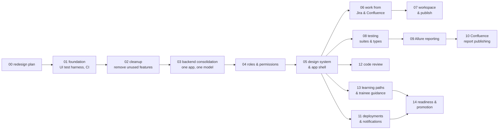

# 6. Implementation plan

Each phase is one branch and one PR (see [07-delivery-workflow.md](07-delivery-workflow.md)). Phases are ordered so
that the app works after every merge.

## 6.1 Phase map

Phases on the same level can be worked on in parallel after their parent is merged: 06, 08, 11, 12 and 13 after 05.
They touch different modules, so their PRs do not conflict (see section 6.4).

## 6.2 Phases

### Phase 00: `feature/phase_00_redesign_plan`
- **Goal:** agree on the plan.
- **Delivers:** these documents in `docs/redesign/`.
- **UI tests:** none, because there is no code change.

### Phase 01: `feature/phase_01_foundation`
- **Goal:** a safety net before anything moves.
- **Delivers:**
  - A Playwright UI test project in `frontend/e2e/`.
  - Scripts that start the backend on a temporary SQLite database with seeded users, one per role, and the frontend.
  - Smoke tests for today's main screens: login, Home/Dashboard, Projects, Test Runs, AI Assistant, Settings.
  - CI:
    - The branch guard also accepts `feature/phase_*`.
    - A UI-test job runs the Playwright suite.
  - An ESLint configuration that passes.
  - The old root folders `e2e-tests/` and `playwright-tests/` are removed (they target screens that no longer exist).
- **Done when:** the UI tests pass locally and in CI on today's app.

### Phase 02: `feature/phase_02_cleanup`
- **Goal:** remove what does not serve the goals.
- **Delivers:**
  - Deleted: office booking, billing and subscriptions, multi-organization, messaging, UnifiedWork agents, mock
    privacy, data-export and webhook settings, dead frontend code (`src/app/**`, unused components, Next.js
    leftovers), unused dependencies, one-off root scripts.
  - Removed from the navigation: Community, until phase 13 decides whether Q&A stays inside Learning.
  - Fixed: the Romanian error text and `lang="ro"`; the Tailwind content paths; the fixed seed passwords, which now
    come from environment variables in development only.
- **UI tests:** the remaining screens still load. Removed routes redirect to Home.

### Phase 03: `feature/phase_03_backend_consolidation`
- **Goal:** one backend and one data model.
- **Delivers:**
  - The `app/` layout from [03-target-architecture.md › 3.3](03-target-architecture.md#33-backend-modules).
  - `backend/main.py` becomes the start script.
  - Moved into modules: the v1 features the UI needs (Jira, Confluence and Zephyr settings, Publish: branch, commit,
    push, PR, scripts run, library install, workflow dispatch, local sync). The four features that return 404 today
    work again.
  - One SQLAlchemy engine and one `Base`. Alembic baseline for SQLite (and Postgres), including today's tables.
  - The repeated checkout-path code is replaced by one helper.
  - Personal tokens move to an encrypted `user_connections` table.
  - The frontend `api.ts` loses its compatibility fallbacks.
- **UI tests:** Publish (commit, push to a local bare repository, PR request), Scripts run, Jira/Confluence settings,
  and everything from phase 01.

### Phase 04: `feature/phase_04_roles_permissions`
- **Goal:** the six roles and the two tags, enforced.
- **Delivers:**
  - Role and tag columns, the migration of existing users ([04-roles-and-permissions.md › 4.5](04-roles-and-permissions.md#45-migration-of-existing-users)).
  - `app/core/permissions.py` and the `require(...)` dependency on every endpoint.
  - Project membership, and `/api/me` with permissions.
  - Users screen: role, tag, lead and projects can be set and are saved (today they are silently dropped).
  - Frontend: `usePermission`, `<Can>`, and guarded routes and navigation.
- **UI tests:** log in as each of the six roles and check the visible navigation and the allowed and hidden actions.
  A Lead changes a User into a Senior.

### Phase 05: `feature/phase_05_design_system_shell`
- **Goal:** the new look and navigation.
- **Delivers:**
  - Design tokens and the `src/ui/` component kit ([05-design.md › 5.6](05-design.md#56-component-kit-srcui)).
  - The new app shell: side bar, top bar, project switcher, command palette, notification bell (UI only).
  - Home per role.
  - Existing screens moved into the seven areas, with their current function, restyled.
  - TanStack Query introduced.
  - URL-driven tabs.
- **UI tests:** navigation per role, command palette, theme switch, keyboard navigation, every area loads, and old
  URLs redirect to the new ones.

### Phase 06: `feature/phase_06_work_requirements`
- **Goal:** work from Jira and Confluence.
- **Delivers:**
  - The Work inbox (Jira stories and technical stories, Confluence pages), with the detail panel.
  - Work items and the board.
  - "Start work": test selection, then branch, then workspace with the story as AI context.
  - Traceability links.
  - Jira write-back: comment and link, plus status when allowed.
- **UI tests:** run against a mocked Jira and Confluence (a fake server in the test harness). Open a story, start
  work, check that the branch is created and the workspace opens with the story attached.

### Phase 07: `feature/phase_07_workspace_publish`
- **Goal:** the daily editor flow.
- **Delivers:**
  - The workspace from [05-design.md › Workspace](05-design.md#workspace-the-editor-improved-from-todays-ai-assistant-tab):
    explorer, tabs, review, assistant panel.
  - The bottom action bar: run changed tests, commit & push, open PR.
  - Standard hints.
  - The Repository screens merged into it (3-Panel, Compare and Editor become views of the workspace).
- **UI tests:** edit and save a file, run changed tests, commit and push to a local bare repository, open a PR
  against a mocked GitHub, review an AI proposal using a mocked provider.

### Phase 08: `feature/phase_08_testing_suites`
- **Goal:** all test types.
- **Delivers:**
  - Suites with test types, runner and target.
  - Environments per project.
  - The run dialog (suite, changed tests or file; environment; local or Actions).
  - Schedules: one in-process scheduler for the station; it can move to a worker later.
  - The run view with performance metrics for k6.
- **UI tests:** create a suite of each type with sample projects from the starter templates; run a functional and a
  performance suite; schedule a suite and see it start.

### Phase 09: `feature/phase_09_allure_reporting`
- **Goal:** one report for every framework.
- **Delivers:**
  - `allure-results` for every runner (adapters, or ATM converters for JUnit, Bruno, Newman and k6).
  - `allure generate` with history.
  - The Reports area: list, embedded report, trends.
  - Today's custom HTML report is retired.
- **UI tests:** run a Bruno and a Playwright sample, open both reports, and check that the trend shows two points
  after two runs.

### Phase 10: `feature/phase_10_confluence_reports`
- **Goal:** publish reports to Confluence.
- **Delivers:** the publishing flow agreed in open topic T1: target space and page per project, page template,
  attachments, history of publications.
- **UI tests:** publish to a mocked Confluence; check the request content and the status in ATM.

### Phase 11: `feature/phase_11_deployments_notifications`
- **Goal:** know when to test.
- **Delivers:**
  - Signed deployment webhook and deployment timeline.
  - Service map.
  - Notification centre (WebSocket), with subscriptions.
  - Notifications for deployments, finished runs, review requests and promotions.
  - Environment checks agreed in open topic T2. Email or Teams per open topic T3.
- **UI tests:** post a signed webhook; the tester of that project sees the notification and opens the deployment.

### Phase 12: `feature/phase_12_code_review`
- **Goal:** seniors review pull requests in ATM.
- **Delivers:**
  - Reviews area: PR list ("waiting for me", "all open") and PR view (files, diff, comments, checks, ATM runs of the
    branch, linked story).
  - Comment, approve and request changes.
  - AI review suggestions.
- **UI tests:** against a mocked GitHub. A Senior approves a PR, a User sees no Approve button, and a comment on a
  line is sent with the right position.

### Phase 13: `feature/phase_13_learning_paths`
- **Goal:** guide manual testers.
- **Delivers:**
  - Learning area: paths built from today's content, with progress saved on the server and shuffled quizzes.
  - Practice tasks with mentor review.
  - Hint library shared with the workspace.
  - AI tutor mode.
  - Mentor view.
  - Decision on Community: keep as learning Q&A, or remove.
- **UI tests:** a Trainee completes a lesson and a quiz; their progress survives a reload and appears in the Lead's
  mentor view.

### Phase 14: `feature/phase_14_readiness_promotion`
- **Goal:** leads decide when a trainee or user moves up.
- **Delivers:**
  - Readiness view with the agreed criteria (open topic T4).
  - Readiness requests.
  - The promotion decision with a note.
  - Audit log entry.
  - Notification to the user.
- **UI tests:** a Lead promotes a Trainee to User; the user's navigation and permissions change at the next page
  load.

## 6.3 Phase size and order

| Phase | Size | Risk | Why here |
|---|---|---|---|
| 01 Foundation | S | Low | The UI tests protect every later phase |
| 02 Cleanup | M | Low | Less code to move and secure in 03 and 04 |
| 03 Consolidation | L | High | Everything else builds on one backend. Done before the new UI so that the UI is built once |
| 04 Roles | M | Medium | New features are built with permissions from the start |
| 05 Shell | L | Medium | Gives every feature phase its place in the navigation |
| 06–14 Features | M each | Medium | Independent modules, built one by one or in parallel |

## 6.4 Avoiding conflicts between open PRs

- **Branch from the latest `main`.** Each phase branches from the latest `main` after its parent is merged. Before a
  PR is opened, the branch is rebased on `main` and the full UI test suite is run again.
- **One module per phase.** From phase 05 on, the feature phases each add their own folders:
  `backend/app/modules/<name>/` and `frontend/src/features/<name>/`.
- **Shared files are touched in a fixed, small way.**
  - The router registration, the side-bar list and the permission matrix each get one line per module.
  - Each feature phase adds its own Alembic revision, chained on the latest revision of `main` at the moment the PR
    is opened. If another phase was merged in between, the revision is re-chained during the rebase.
- **Phases that depend on each other** (for example 07 on 06, 10 on 09) are not opened at the same time. The second
  PR is opened after the first is merged. If that is ever needed for speed, the second PR is stacked on the first
  branch and says so in its description.
